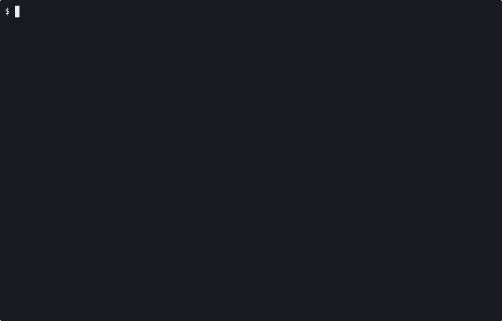

#  Terrarium

**Give your agent room to work. Decide what it can touch.**

Terrarium runs agents and development tools in lightweight virtual machines
called boxes. Each box has its own kernel and disk, and it sees only the host
folders and network destinations you allow. You need one program, `terra`, and
a short YAML recipe.

[](https://github.com/terrarium-sh/terrarium/actions)
[](https://github.com/terrarium-sh/terrarium/releases/latest)
[](LICENSE)

> [!WARNING]
> **Under construction.** The docs are incomplete and the code is still under
> internal review.



## What you can do with it

- **Run your coding agent in a box.** Run Claude Code, Codex or your own tools
  on your project inside a VM, not directly on your machine.
  [Start with the quickstart →](#quickstart)
- **Give an agent a long-term home.** Its tools and files stay between
  restarts, and systemd can keep it running.
  [Set one up →](docs/usage.md#a-terrarium-for-agents)
- **Try things you don't trust.** Unknown installers, untrusted builds and
  one-off scripts run in a box. You can also publish a box's services on host
  loopback.

## Install

Terrarium runs on Linux (amd64, aarch64), macOS on Apple Silicon, and Windows
(amd64, ARM64). Linux needs access to `/dev/kvm`. Windows needs the Windows
Hypervisor Platform feature turned on. More detail is in the
[platform requirements](packaging/README.md#native-host-builds).

**Linux and macOS:**

```sh
curl -fsSL https://raw.githubusercontent.com/terrarium-sh/terrarium/main/install.sh | sh
```

**Windows (PowerShell):**

```powershell
irm https://raw.githubusercontent.com/terrarium-sh/terrarium/main/install.ps1 | iex
```

On Windows, open a new terminal after installing. Other ways to install are in
the [usage guide](docs/usage.md#installation-options).

## Quickstart

This example sets up a box for a Node.js project.

**1. Write a recipe.** In your project folder, create `dev.yaml`:

```yaml
hw:
  cpus: 2
  mem_mib: 2048
  rootfs_mib: 4096
mounts:
  - host: .
    guest: /work
    readonly: false
network:
  mode: allowlist
  allow:
    - dl-cdn.alpinelinux.org:443
    - registry.npmjs.org:443
hooks:
  on_create:
    - apk add --no-cache nodejs npm git
workload:
  entrypoint: /bin/sh
  workdir: /work
```

This recipe:

- gives the box 2 CPUs, 2 GiB of memory and a 4 GiB disk;
- shares your project folder at `/work`, so edits show up on both sides;
- allows HTTPS only to the Alpine and npm package registries;
- installs Node.js, npm and Git the first time the box is created.

If your tools need other sites, add them to `network.allow`.
For more ready-made recipes, see
[terrarium_examples](https://github.com/terrarium-sh/terrarium_examples).

**2. Create the box and go in:**

```sh
terra ./dev.yaml setup   # create the box and install the tools
terra                    # open a shell in the box at /work
```

**3. Leave and come back.** Press `Ctrl-\` to detach. The box keeps running.

| Command | What it does |
| --- | --- |
| `terra` | Go back into the box's shell |
| `terra exec -- node --version` | Run one command in the box |
| `terra stop` | Stop the box (its files are kept) |
| `terra rm` | Delete the box and its storage |

> [!IMPORTANT]
> The box can edit your project folder, and that includes `dev.yaml`. Check the
> recipe before you run `setup` again. See [recipe trust](docs/security.md#where-recipes-live).

To change tools, access or the workload, see the [recipe reference](docs/recipe.md).

## Why Terrarium

- **Nothing is allowed until you allow it.** A new box sees no host files and
  has no network. You choose which folders it gets, whether they are read-only,
  and which hosts, IPs or ranges and ports it can reach.
- **A real VM, not a container.** Each box runs its own kernel under hardware
  virtualization, so even root inside the box stays inside.
- **More layers around the VM.** The code that handles the box's device requests
  runs in separate WebAssembly sandboxes. The VM process and network broker also
  run in the host OS sandbox: Bubblewrap and seccomp on Linux, Seatbelt on
  macOS, and Less-Privileged AppContainers on Windows.
- **No daemon, nothing extra to install.** The guest kernel, base system and VM
  parts are built into `terra`.
- **One narrow path, less to trust.** Every box boots the same kernel and the
  same Alpine release, built for your machine's CPU. There are no OCI images,
  registries or architecture matrix to configure, or to get wrong.
- **Your work stays put.** Detach and rejoin, run commands, or sync files without
  rebuilding. The box's storage persists across restarts.

To learn what Terrarium protects against and where it stops, read the
[security model](docs/security.md).

## Learn more

- [Usage guide](docs/usage.md): install options, commands, file sync and storage.
- [Recipe reference](docs/recipe.md): network access, mounts, packages and workloads.
- [Project manifest](docs/manifest.md): manage several boxes with `terra.yaml`.
- [Agent skill](docs/usage.md#let-an-agent-build-the-box): let your coding agent
  write and set up boxes from your requirements.
- [Security model](docs/security.md): trust boundaries, enforcement and limits.
- [Host process sandboxing](docs/sandboxing.md): which processes a box uses and
  how each OS confines them.
- [Host sandbox policy](docs/sandbox-policy.md): built-in confinement and the
  generated Linux syscall allowlists.
- [Packaging](packaging/README.md): platform requirements, systemd and man pages.
- [Development](README.dev.md): build from source, test, run the acceptance gates
  and release.
- [Security policy](SECURITY.md): report a vulnerability privately.

Apache-2.0. See [LICENSE](LICENSE) and [NOTICE](NOTICE).
